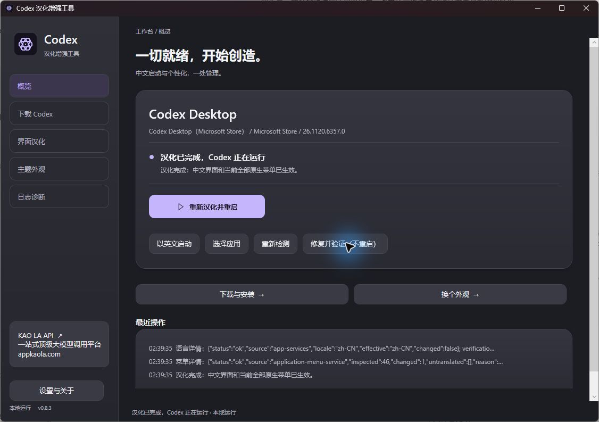

# Codex Desktop Chinese Localization Enhancer

English | [简体中文](README.md)


[](https://github.com/shibaweidu/codex-desktop-zh/releases/latest)


**Codex Desktop Chinese Localization Enhancer** is a Windows and macOS launcher for enabling the Chinese UI and translating native Electron menus in Codex Desktop. It supports Microsoft Store, portable, and macOS App Bundle installations, verified process shutdown, and automatic restart in Chinese mode.

Localization does not unpack or replace `app.asar`, modify the Microsoft Store installation, or read Codex accounts, tokens, and project files. A separately confirmed Codex client update deploys a new package or replaces Codex.app.

## Download

[Windows x64 EXE](https://github.com/shibaweidu/codex-desktop-zh/releases/latest/download/Codex-Zh-Launcher-Windows-x64.exe) · [macOS Apple Silicon ZIP](https://github.com/shibaweidu/codex-desktop-zh/releases/latest/download/Codex-Zh-Launcher-macOS-arm64.zip) · [macOS Intel ZIP](https://github.com/shibaweidu/codex-desktop-zh/releases/latest/download/Codex-Zh-Launcher-macOS-x64.zip) · [SHA256SUMS.txt](https://github.com/shibaweidu/codex-desktop-zh/releases/latest/download/SHA256SUMS.txt)

Current version: **[v0.8.3](https://github.com/shibaweidu/codex-desktop-zh/releases/tag/v0.8.3)**. This release adapts to newer Codex settings and Windows menu services, corrects language verification, and adds Windows repair without restarting. The download links above always select the latest stable release.



Actual v0.8.3 pre-release acceptance screenshot with Codex 26.1120.6357.0. All 46 labels in the inspected menu snapshot passed; this does not promise coverage of every page, third-party plugin description, or future release.

## Client updates and appearance

Version 0.8.2 adds direct mirror downloads, resume support, and package cache reuse to the Windows Codex updater. The updater checks the current user's registered package after deployment and shows Windows errors when deployment fails.

The native WPF / SwiftUI workspace provides Overview, Codex updates, Localization, Appearance, and Diagnostics. Client updates and launcher updates are separate operations. See the [update guide](docs/UPDATES.md) (Chinese).

Codex client updates use the Wangnov community mirror on both platforms. The launcher detects the local version and CPU architecture, skips downloads when current, and downloads and verifies an available update. Windows compares MSIX package versions, resumes interrupted downloads, and reuses verified packages for the same version. After confirmation, Windows deploys with AppX and checks the registered version for the current account. macOS compares the app version and build number, verifies Apple signing, Team ID and architecture, then replaces and restarts Codex after confirmation. The system Applications directory may require macOS administrator authorization. Windows installation requires closing Codex first. Update portable Windows builds through their original installation channel.

Six reversible runtime color presets apply to launcher-created, process-verified sessions. A full page refresh can remove the runtime style.

Published releases include both Mac architectures. The current v0.8.3 changes have passed Windows builds, isolated tests, local integration, and CI builds/tests on both Mac architectures. Real Codex localization on Mac still requires manual acceptance. See the [v0.8.3 acceptance record](docs/LOCALIZATION-v0.8.3.md) (Chinese).

## Features

- Detects the Microsoft Store version of Codex Desktop
- Supports portable `Codex.exe` and `ChatGPT.exe` installations
- Detects `Codex.app` and `ChatGPT.app` in `/Applications` and `~/Applications`
- Provides a native SwiftUI application for Apple Silicon and Intel Macs running macOS 13+
- Selects Codex's built-in Chinese resources through current settings services, retaining older settings-bridge and i18n configuration compatibility
- Offers Windows repair and verification without restarting when an existing local endpoint can be verified
- Translates native Electron application menus at runtime
- Reports menu labels that need compatibility updates
- Safely closes a running Codex instance before localization and restart
- Revalidates the PID, executable path, and start time before termination
- Provides native dark five-page WPF and SwiftUI interfaces with local diagnostic logs
- Optionally checks GitHub Releases at startup; confirmation starts verified download, replacement, and restart
- Provides an About view with version, update, support, and repository actions
- The launcher requires no administrator privileges for normal use; updating Codex under system Applications may request macOS authorization
- Does not patch official app files; Codex.app is replaced only after the user confirms a client update

## Download and Usage

Download the matching asset and `SHA256SUMS.txt` from [GitHub Releases](https://github.com/shibaweidu/codex-desktop-zh/releases/latest):

| System | Asset |
|---|---|
| Windows 10/11 x64 | `Codex-Zh-Launcher-Windows-x64.exe` |
| Apple Silicon | `Codex-Zh-Launcher-macOS-arm64.zip` |
| Intel Mac | `Codex-Zh-Launcher-macOS-x64.zip` |

On macOS, unzip the app, move it to Applications, then right-click it and select Open. If macOS still blocks it, use System Settings > Privacy & Security > Open Anyway. Do not disable Gatekeeper or enable applications from anywhere.

1. Run the launcher for your platform.
2. Wait for Codex Desktop detection to complete.
3. Select **汉化并启动** when Codex is not running.
4. Select **关闭并汉化重启** when Codex is already running.
5. Review the visible log for UI and native-menu verification results.

## Safety Model

Windows only handles `Codex.exe` and `ChatGPT.exe` processes from the detected Store package or selected portable directory. macOS only handles the main executable and Helper processes inside the selected Codex App Bundle. Processes with an unreadable path or a reused PID are never terminated.

The shutdown sequence requests a graceful exit, waits five seconds, revalidates every remaining process, performs forced termination when necessary, waits up to eight seconds, and restarts only when no candidate process remains.

## How It Works

The launcher allocates two random loopback ports for each Codex session:

- Chromium DevTools for applying the official `localeOverride` setting
- Renderer menu services on newer Windows clients, with Electron main-process inspector support for older Windows clients and macOS

Both endpoints bind to `127.0.0.1`. Localization and color presets do not change Codex installation files.

## Compatibility

| Platform | Installation | Status |
|---|---|---|
| Windows 10/11 x64 | Microsoft Store | Supported |
| Windows 10/11 x64 | Portable | Supported |
| Windows ARM64 | Any | Untested |
| macOS 13+ Apple Silicon | App Bundle | Supported |
| macOS 13+ Intel | App Bundle | Supported |
| Linux | Any | Not supported yet |

Codex updates may change Electron arguments, settings contracts, or menu labels. Open a compatibility issue with the Codex version, diagnostics output, and a redacted launcher log when this happens.

## Updates

The launcher checks this repository's latest GitHub Release at startup. After confirmation, it downloads the platform asset and `SHA256SUMS.txt`, verifies them, backs up and replaces the current EXE or App Bundle, and restarts. Failed replacements restore the previous version and offer the manual download page.

The macOS updater verifies the archive hash, Bundle ID, version, architecture, and ad-hoc signature before replacement. It works without an Apple Developer ID, but it cannot provide an Apple-recognized publisher identity and future Gatekeeper policy may still block the restarted app.

## Build and Test

The Windows application uses WPF and the .NET Framework 4.8 compiler. The macOS application uses Swift 5.9, Swift Package Manager, and SwiftUI.

```powershell
powershell -NoProfile -ExecutionPolicy Bypass -File .\build.ps1
powershell -NoProfile -ExecutionPolicy Bypass -File .\test-shutdown.ps1
.\dist\Codex-Zh-Launcher-Windows-x64.exe --self-test
.\dist\Codex-Zh-Launcher-Windows-x64.exe --diagnostics
```

```bash
bash scripts/test-macos.sh
bash scripts/build-macos.sh arm64
bash scripts/build-macos.sh x86_64
```

The packaged macOS app exposes `--self-test`, `--diagnostics`, `--launch-zh`, and `--launch-en` through `Contents/MacOS/CodexZhLauncherMac`. There is intentionally no force-close CLI command.

## Source Layout

Commit `src/`, `tests/`, `macos/`, `shared/`, `scripts/`, the PowerShell build/test scripts, repository documentation, and `.github/` automation. Do not commit `dist/`, `obj/`, `macos/.build/`, `macos/.artifacts/`, local logs, Codex installation files, credentials, tokens, or user project content.

See [docs/PUBLISHING.md](docs/PUBLISHING.md) for repository and release instructions.

## Sponsorship

Left sidebar sponsor: [**KAO LA API**](https://www.appkaola.com) — “One-stop access to leading large language models.” Sponsorship does not imply endorsement by or an official partnership with OpenAI, Microsoft, or Codex.

## License and Trademark Notice

This project is independently implemented and released under the [MIT License](LICENSE). It does not contain CodexPlusPlus source code or distribute Codex Desktop.

Codex, OpenAI, and related trademarks belong to their respective owners. This is not an official OpenAI, Microsoft, or Codex project.
