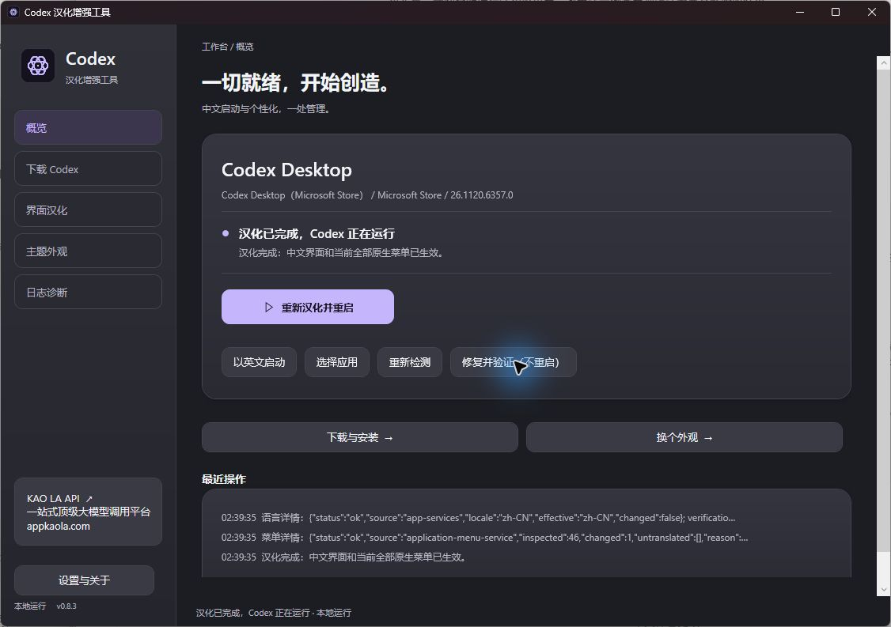

# Codex 汉化工具 · Codex Desktop 中文汉化增强工具

[English](README.en.md) | 简体中文


[](https://github.com/shibaweidu/codex-desktop-zh/releases/latest)


**Codex Desktop 中文汉化增强工具**是一款面向 Windows 和 macOS 的开源 Codex 汉化工具，提供中文界面、菜单翻译、客户端下载更新和主题配色。支持 Windows Microsoft Store、便携版以及 macOS Apple Silicon / Intel 应用。

An open-source Codex Desktop Chinese localization tool for Windows and macOS, with menu translation, client updates, and runtime color presets.

汉化过程不解包、不替换 `app.asar`，不修改 Microsoft Store 安装目录，也不读取 Codex 账号、令牌或项目文件。

## 立即下载

| 系统 | 下载最新版汉化工具 |
|---|---|
| Windows 10/11 x64 | [下载 Windows EXE](https://github.com/shibaweidu/codex-desktop-zh/releases/latest/download/Codex-Zh-Launcher-Windows-x64.exe) |
| Mac Apple Silicon（M 系列） | [下载 macOS arm64 ZIP](https://github.com/shibaweidu/codex-desktop-zh/releases/latest/download/Codex-Zh-Launcher-macOS-arm64.zip) |
| Mac Intel | [下载 macOS x64 ZIP](https://github.com/shibaweidu/codex-desktop-zh/releases/latest/download/Codex-Zh-Launcher-macOS-x64.zip) |

[全部版本与更新说明](https://github.com/shibaweidu/codex-desktop-zh/releases) · [SHA-256 校验文件](https://github.com/shibaweidu/codex-desktop-zh/releases/latest/download/SHA256SUMS.txt) · [Windows 教程](docs/WINDOWS.md) · [macOS 教程](docs/MACOS.md) · [问题排查](docs/TROUBLESHOOTING.md)

当前版本：**[v0.8.3](https://github.com/shibaweidu/codex-desktop-zh/releases/tag/v0.8.3)**。本次修复新版 Codex 的语言设置与 Windows 菜单兼容问题，新增“修复并验证（不重启）”。以上下载入口始终指向最新正式版，详见 [更新记录](CHANGELOG.md)。

v0.8.2 为 Windows Codex 更新加入直连镜像、断点续传和缓存复用。部署后核对当前账户注册的版本，失败时显示 Windows 返回的错误。安装前继续校验 SHA-256、有效签名及发布者身份。

## 界面预览



本机实拍：Windows v0.8.3 发布前验收构建，对 Codex `26.1120.6357.0` 执行“修复并验证（不重启）”后的成功状态。当前菜单检查 46 项，未覆盖列表为空。截图不代表所有 Codex 版本或所有第三方插件内容均已翻译。

## 客户端下载与主题外观

原生 WPF / SwiftUI 五页工作台包含：**概览、下载 Codex、界面汉化、主题外观、日志诊断**。采用深色界面和淡紫强调色，赞助入口位于左侧栏。客户端下载与汉化工具自身更新是两个独立流程，详见 [下载与更新说明](docs/UPDATES.md)。

- **社区镜像更新**：Windows 和 macOS 均使用 Wangnov 社区镜像，自动识别本机版本与芯片，有新版时下载并校验。Windows 按 MSIX 包版本比较，支持暂停续传与同版本缓存，确认后由 AppX 为当前账户部署并复核注册版本。macOS 先比较应用版本，再比较构建号，确认后校验 Apple 签名、Team ID 和架构并覆盖重启。系统 Applications 目录可能要求 macOS 管理员授权。Windows 更新要求先退出 Codex，便携版使用原安装渠道更新。
- **运行时配色**：六款项目自有纯色预设和 12–18 字号预览。仅向本工具启动且进程身份仍可验证的会话添加自有 style，恢复时只移除该 style；不修改客户端文件、原生设置、菜单或代码语法配色。完整页面刷新后可能需要重新应用，不承诺新版 Codex 全部组件均适配。
- **工具强调色**：只改变工具的主按钮、选中导航和进度强调色，保留深色材质；纸白预设在深色工具中使用淡紫回退以保持可读性。
- **日志与设置**：日志搜索、提示/错误筛选、复制、导出；支持关闭启动时自动检查更新。

已发布版本提供 Windows 与 macOS 双架构下载包。v0.8.3 本轮改动在 Windows 完成构建、隔离测试和本机汉化验收，macOS 两种架构的 CI 构建与测试也已通过；真实 Mac 上的 Codex 汉化仍需人工验收。详见 [本轮修复验收](docs/LOCALIZATION-v0.8.3.md)。

## 主要功能

- 自动检测 Microsoft Store 版 Codex Desktop
- 支持手动选择便携版 `Codex.exe` 或 `ChatGPT.exe`
- 自动检测 `/Applications` 和 `~/Applications` 中的 `Codex.app` / `ChatGPT.app`
- 原生 SwiftUI macOS 13+ 界面，分别支持 Apple Silicon 与 Intel
- 使用 Codex 自带中文资源，优先接入新版设置服务，同时保留旧版动态配置与设置桥兼容
- 运行时翻译文件、编辑、视图、窗口、帮助等应用菜单，并单独报告验证结果
- 自动记录新版 Codex 中尚未覆盖的菜单标签
- Codex 已运行时显示“关闭并汉化重启”
- 先请求正常退出，5 秒后仅强制终止经过路径验证的剩余进程
- 深色 WPF / SwiftUI 界面、实时状态和本地诊断日志
- 启动时自动检查 GitHub Releases，确认后下载、校验、覆盖并重启工具
- 关于界面提供版本、手动检查更新、反馈支持和项目仓库入口
- 工具日常运行无需管理员权限；更新系统 Applications 中的 Codex 时，macOS 可能要求管理员授权
- 不修改 Codex 官方文件，只有用户确认客户端更新后才替换 Codex.app

## 下载与使用

从 [GitHub Releases](https://github.com/shibaweidu/codex-desktop-zh/releases/latest) 下载对应系统的文件和 `SHA256SUMS.txt`：

| 系统 | 下载文件 |
|---|---|
| Windows 10/11 x64 | `Codex-Zh-Launcher-Windows-x64.exe` |
| Apple Silicon（M1/M2/M3/M4） | `Codex-Zh-Launcher-macOS-arm64.zip` |
| Intel Mac | `Codex-Zh-Launcher-macOS-x64.zip` |

Windows 直接运行 EXE。macOS 解压 ZIP 后，将应用拖到“应用程序”，首次启动请右键应用并选择“打开”。若仍被阻止，前往“系统设置 > 隐私与安全性”，在安全性区域为该应用选择“仍要打开”，确认来源后再继续。不要启用“任何来源”，也不要关闭 Gatekeeper。

1. 运行对应平台的“Codex 汉化增强工具”。
2. 等待工具自动检测 Codex Desktop。
3. Codex 未运行时，点击“汉化并启动”。
4. Codex 已运行时，点击“关闭并汉化重启”，阅读提示后确认。
5. 在运行日志中查看中文界面和原生菜单的验证结果。

Windows v0.8.3 起提供“修复并验证（不重启）”。它只连接当前安装进程拥有的可验证回环接口；不支持此接口的会话需要先保存工作，再使用确认后的关闭重启流程。

软件关闭后，Codex 不会立刻变回英文。`localeOverride` 会由 Codex 保存；原生菜单翻译属于当前进程的运行时补丁，因此以后需要完整菜单汉化时仍建议通过本工具启动。

## 状态说明

| 状态 | 含义 |
|---|---|
| 汉化已完成 | 中文界面和当前全部原生菜单均通过验证 |
| 界面已汉化，菜单待确认 | 中文界面生效；可能存在未覆盖标签，也可能是菜单接口无法连接，需查看详情 |
| 菜单已汉化，界面待确认 | 原生菜单已翻译，但页面语言检测暂时无法确认 |
| 汉化未完全生效 | 中文界面和菜单均未通过完整验证；此状态本身不能说明具体失败原因 |

这些状态描述的是本次启动的验证结果，不代表 Codex 安装损坏，也不代表必须重新安装客户端。

## 安全关闭机制

Windows 只处理当前 Store 安装目录或所选便携版目录中的 `Codex.exe` / `ChatGPT.exe`。macOS 只处理所选 `Codex.app` / `ChatGPT.app` Bundle 内的主程序和 Helper 进程。

- 关闭前始终显示确认对话框
- 先请求主窗口正常退出并等待 5 秒
- 强制终止前重新验证 PID、可执行路径和进程启动时间
- 路径无法验证或 PID 已被复用时拒绝终止
- 强制终止后最多等待 8 秒
- 仍有候选进程时停止自动重启

## 工作原理

启动器为本次 Codex 进程分配两个随机回环端口：

- Chromium DevTools 端口：调用 Codex 设置服务或旧设置桥，应用并验证 `localeOverride`
- 新版 Windows 菜单通过渲染页面的菜单服务翻译；旧版 Windows 与 macOS 使用 Electron 主进程 inspector

两个端口都绑定到 `127.0.0.1`。汉化和配色只使用运行时补丁；用户另行确认客户端更新时，工具会部署 Windows 包或替换 Codex.app。

## 兼容性

| 平台 | 安装类型 | 支持状态 |
|---|---|---|
| Windows 10/11 x64 | Microsoft Store | 支持 |
| Windows 10/11 x64 | 便携版 | 支持 |
| Windows ARM64 | 任意 | 未验证 |
| macOS 13+ Apple Silicon | App Bundle | 支持 |
| macOS 13+ Intel | App Bundle | 支持 |
| Linux | 任意 | 暂不支持 |

OpenAI 更新 Electron 启动参数、设置接口或菜单结构后，本工具可能需要同步适配。遇到兼容问题时，请提交“Codex 版本兼容”Issue，并附上诊断输出和已脱敏日志。

## 构建与测试

Windows 使用系统自带的 .NET Framework 4.8 编译器和 WPF；macOS 使用 Swift 5.9、Swift Package Manager 和 SwiftUI。环境准备、构建命令和回归测试见 [贡献指南](CONTRIBUTING.md)。

## 上传到 GitHub 的文件

源码目录、忽略文件和发布包清单见 [贡献指南](CONTRIBUTING.md) 与 [发布说明](docs/PUBLISHING.md)。编译后的程序放入 Releases，用户日志、账号信息和 Codex 官方安装文件不提交到仓库。

## 日志与隐私

日志位置：

```text
%LOCALAPPDATA%\CodexZhLauncher\logs\launcher.log
```

macOS 日志位于：

```text
~/Library/Logs/CodexZhLauncher/launcher.log
```

日志包含 Codex 安装类型、版本、汉化验证结果和进程关闭统计。提交 Issue 前应检查并移除不希望公开的本机路径或其他信息。

## 常见问题

### 工具会自动更新吗？

工具会在启动后检查本仓库的最新 GitHub Release，发现新版时询问是否立即更新，也可以在“关于”界面手动检查。确认后会下载对应平台文件和 `SHA256SUMS.txt`，校验通过后退出当前工具、备份旧版本、覆盖并自动重启；失败时恢复旧版本并提供手动下载入口。

### macOS 没有 Apple Developer ID 签名还能检查更新吗？

可以。更新检查与覆盖不依赖 Apple Developer ID。macOS 会校验 ZIP 哈希、Bundle ID、版本、CPU 架构和 ad-hoc 签名后再替换 `.app`；但没有 Developer ID 和公证仍无法提供苹果认可的发布者身份，Gatekeeper 策略变化时仍可能阻止重启后的应用。

### Codex 更新后还可以继续使用吗？

小版本更新通常可以继续使用。如果设置接口、Electron 参数或菜单标签发生变化，工具可能显示具体未生效环节，并需要发布兼容更新。

### 为什么普通快捷方式启动后菜单还是英文？

菜单翻译是运行时补丁。普通快捷方式启动的会话通常没有本工具需要的本地调试接口，建议保存工作后通过工具重新启动；v0.8.3 的“不重启修复”也要求已有可验证接口。

### 工具会修改 Codex 安装包吗？

汉化功能不会修改 `app.asar` 或 Codex 可执行文件。用户确认“下载 Codex”页面中的客户端更新后，会由系统部署新包或替换 Codex.app；详见 [两类更新的区别](docs/UPDATES.md)。

### Windows 提示无法验证发布者怎么办？

当前构建可能没有商业代码签名。请只从本仓库 Releases 下载，并使用 `SHA256SUMS.txt` 校验文件；不要关闭 Windows 的整体安全保护。

### macOS 为什么提示无法验证开发者？

macOS ZIP 使用免费的 ad-hoc 签名，没有 Apple Developer ID 签名和公证，因此首次打开可能出现 Gatekeeper 提示。请使用上文的右键“打开”或“隐私与安全性 > 仍要打开”，不要执行关闭 Gatekeeper、允许任何来源或自动清除 quarantine 的命令。

## 赞助支持

左侧赞助商：**[KAO LA API](https://www.appkaola.com)** — 一站式顶级大模型调用平台。赞助关系不代表 OpenAI、Microsoft 或 Codex 对该服务的认可或官方合作。

## 贡献与安全

- 提交代码前请阅读 [CONTRIBUTING.md](CONTRIBUTING.md)
- 安全问题请按照 [SECURITY.md](SECURITY.md) 私下报告
- 版本变化参见 [CHANGELOG.md](CHANGELOG.md)

## 许可证与声明

项目采用 [MIT License](LICENSE)，实现为独立编写，不包含 CodexPlusPlus 源码，也不分发 Codex Desktop 安装包。

Codex、OpenAI 和相关商标归其权利人所有。本项目不是 OpenAI、Microsoft 或 Codex 官方产品。
