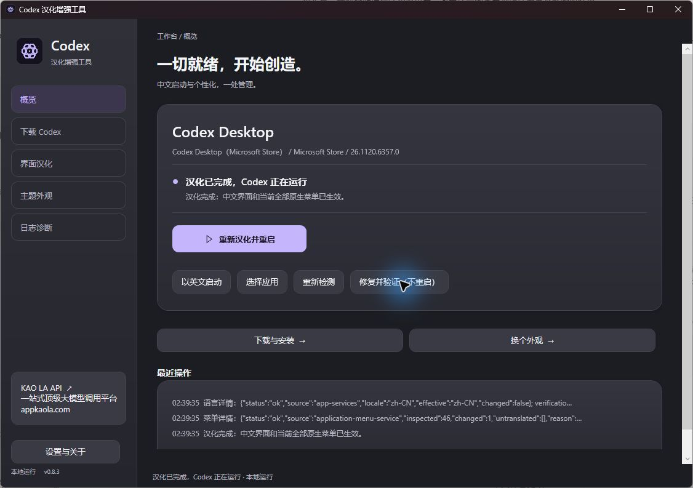

# v0.8.3 汉化兼容修复与验收

版本：v0.8.3。发布前验收日期：2026-11-28。

## 修复的问题

Codex `26.1120.6357.0` 已拒绝旧的语言设置 fetch 请求，并通过页面内服务提供 Windows 菜单。旧工具仍依赖旧请求与 Node inspector，连接失败后把菜单报告为“仍有未翻译项”。页面检测还只识别少量旧标签，导致已是中文的页面被误判。

v0.8.3 使用当前客户端的设置服务读写 `localeOverride`，并验证可见界面控件。Windows 菜单通过 applicationMenu 服务翻译，保留原命令 ID、快捷键和启用状态，补充“在聊天与标签页之间切换”。旧版启动流程保留兼容路径。

新增 Windows“修复并验证（不重启）”：只连接经过安装路径、PID、启动时间及监听端口所属进程验证的回环接口，不调用旧版会刷新页面的设置路径，也不连接未经独立验证的 inspector。接口不可用时显示原因，用户可保存工作后使用有确认提示的重启流程。

## 已执行验收

| 检查 | 结果 |
|---|---|
| Windows Release 构建 | 通过 |
| `--self-test` | 通过，包含共享资源和顶层 JSON 状态回归 |
| `--diagnostics` | 通过，检测到 Microsoft Store Codex `26.1120.6357.0` |
| 汉化脚本隔离测试 | 22 项通过：设置服务、RPC 代理、菜单命令保持、重复修复、旧 Electron 菜单、混合语言、正文排除、不重启安全边界 |
| 原有回归 | 主题脚本、56 项工作台服务、MSIX 验证及临时进程关闭测试通过 |
| 本机 `--localize-running` | 语言与菜单均通过；没有关闭、重载或替换真实 Codex |
| Windows 工具界面 | 点击不重启修复后显示成功，已截图 |
| macOS arm64 / x86_64 | 两种架构的 Swift 测试、自检、App Bundle 构建、签名及更新器集成检查均在 CI 通过；真实 Codex 汉化尚未实机验收 |

对应源码与文档提交：`119a5f9`。完整 [三平台 CI 记录](https://github.com/shibaweidu/codex-desktop-zh/actions/runs/46053310246) 已全部通过；发布准备仅补充文档及发布说明读取流程，没有更改已测应用代码。正式发布由 [Release 工作流](https://github.com/shibaweidu/codex-desktop-zh/actions/workflows/release.yml) 重新构建、测试和打包。

本机实际报告摘要：

```json
{
  "locale": {"source":"app-services","effective":"zh-CN","changed":false},
  "verification": {"status":"ok","zhMarkers":8,"enMarkers":0},
  "menu": {"status":"ok","source":"application-menu-service","inspected":46,"changed":1,"untranslated":[]}
}
```



这些结果覆盖本次检查的界面控件与菜单快照，不等于遍历每个设置页、第三方插件描述或所有未来版本的标签。真实 Mac 启动、菜单栏及关闭确认仍需在 Apple Silicon / Intel 机器上人工验收。

返回 [项目介绍](../README.md) · [问题排查](TROUBLESHOOTING.md)
